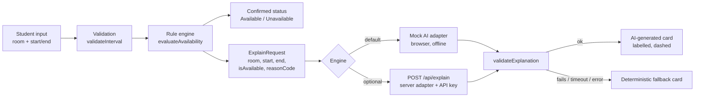

# Smart Campus Room Availability Checker — Practice #11

AI-Driven Software Engineering (KBTU), Practice #11: **build a small AI-enabled feature** and verify it with an **agentic code review**.

The app (Vite + React + TypeScript) checks whether one fictional campus room is free for a chosen time. Practice #11 adds an optional **"Explain availability"** button that turns the rule engine's result into a short, student-friendly explanation. The booking rules stay the only source of truth: the language model may explain the decision, never make or change it.

## Run it

```bash
npm ci
npm run dev        # http://localhost:5173
npm test           # 54 tests
npm run typecheck && npm run lint && npm run build
```

Mock mode (default) needs no key and no network. To try a live model, start the dev server with server-side variables (never `VITE_`):

```powershell
$env:LLM_API_KEY = "<your key>"; $env:LLM_MODEL = "<model id>"; npm run dev
```

Without them, `POST /api/explain` answers `503` and the UI shows the deterministic fallback.

## How a request travels



The decision (step D) is computed before any model is called and is never read back from the model.

## Where things are

| Path | Purpose |
|---|---|
| `src/utils.ts` | Rule engine. `evaluateAvailability` adds reason codes; rules unchanged |
| `src/explain/contract.ts` | Input/output contract, limits, request and output validators |
| `src/explain/prompt.ts` | System instruction and structured user message |
| `src/explain/service.ts` | Timeout, validation and fallback orchestration |
| `src/explain/adapters.ts` | Mock adapter (with failure simulation) and HTTP adapter |
| `server/` | `/api/explain` handler, Vite middleware, live model adapter |
| `src/components/ExplanationPanel.tsx` | "Explain availability" button and labelled result card |
| `docs/` | Feature contract, prompt comparison, test cases, agentic review, reflection, screenshots |

## Deliverables

- [Feature contract and architecture](docs/feature-contract.md)
- [Prompt comparison (Task 04)](docs/prompt-comparison.md)
- [Test cases with expected and observed results (Task 05)](docs/test-cases.md)
- [Agentic code review report (Tasks 06–07)](docs/agentic-review.md)
- [Reflection](docs/reflection.md)
- [Baseline results (Task 01)](docs/baseline/baseline-output.txt)

All data is fictional. No login, no database, no bookings are created or modified.
