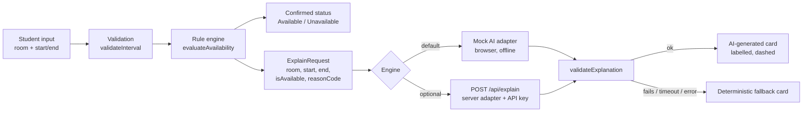

# Smart Campus Room Availability Checker — code-based vs. low-code

AI-Driven Software Engineering (KBTU), **Practice work #12 (Lesson 12): compare code-based and low-code solutions.**

## 🔗 Live demo

- **Code-based (React + TypeScript, GitHub Pages):** https://theleriz.github.io/smart-campus-code-vs-lowcode/
- **Low-code (Appsmith, published):** https://app.appsmith.com/app/smart-campus-room-checker-lowcode/page1-6b0598525441f3e820a02932

Both open without login. In each app press **Run T1–T8** to run the eight acceptance tests, or enter a start time and duration and press **Check availability**.

The same small feature — *is one fictional seminar room free for a chosen start time and duration?* — is built twice against one shared contract (AC1–AC6) and checked with the same eight tests:

| | Code-based | Low-code |
|---|---|---|
| Stack | Vite + React + TypeScript (this repo) | Appsmith Cloud, free plan |
| Where the rules live | [`src/contract/roomContract.ts`](src/contract/roomContract.ts) (pure, no UI) | JS Object `RoomCheck` ([copy in repo](lowcode/appsmith/RoomCheck.js)) |
| UI | [`src/components/RoomContractChecker.tsx`](src/components/RoomContractChecker.tsx) | 10 widgets, see [lowcode/appsmith/README.md](lowcode/appsmith/README.md) |
| Live demo | [GitHub Pages](https://theleriz.github.io/smart-campus-code-vs-lowcode/) (tab **One-room check (Lesson 12)**) | [Appsmith app (public)](https://app.appsmith.com/app/smart-campus-room-checker-lowcode/page1-6b0598525441f3e820a02932) |
| Run locally | `npm ci` → `npm run dev` | – |
| T1–T8 | **8 / 8** | **8 / 8** |

## Report

1. [Shared requirements, acceptance criteria and contract (Tasks 01–02)](docs/lesson-12/requirements.md)
2. [Eight identical tests with expected and observed results + how to run them (Task 05)](docs/lesson-12/test-cases.md)
3. [Engineering effort, comparison matrix and recommendation (Task 06)](docs/lesson-12/comparison.md)
4. [Security review checklist (Task 07)](docs/lesson-12/security-review.md)
5. [Reflection on AI use, incomplete/simulated parts](docs/lesson-12/reflection.md)
6. Screenshots: [docs/lesson-12/screenshots/](docs/lesson-12/screenshots/) · raw outputs: [docs/lesson-12/test-output/](docs/lesson-12/test-output/)

## How to run the tests

```bash
npm ci
npm test            # 109 tests: T1–T8 + boundaries + XSS strings (src/contract), Appsmith parity (lowcode/appsmith), older suites
npm run typecheck && npm run lint && npm run build
npm run dev         # open the page, press "Run T1–T8" in the Lesson 12 tab
```

Browser checks (Playwright Core + Chrome, set `PW_MODULE` to `playwright-core/index.mjs`):

```bash
node docs/lesson-12/ui-check/ui-check.mjs          # code-based app on http://localhost:5179/
node lowcode/appsmith/ui-check-appsmith.mjs        # published Appsmith app
node lowcode/appsmith/access-check.mjs             # anonymous access / data-exposure check
```

In the Appsmith app you can also press **Run T1–T8** or type the inputs from the [test table](docs/lesson-12/test-cases.md).

All data is fictional. No login, no database, no real bookings are created or modified.

---

## Previous practice (Practice #11: "Explain availability")

The second tab, **Full checker (Practices 6–11)**, is the earlier multi-room checker with the optional explanation feature. It is unchanged.

AI-Driven Software Engineering (KBTU), Practice #11: **build a small AI-enabled feature** and verify it with an **agentic code review**.

The app (Vite + React + TypeScript) checks whether one fictional campus room is free for a chosen time. Practice #11 adds an optional **"Explain availability"** button that turns the rule engine's result into a short, student-friendly explanation. The booking rules stay the only source of truth: the language model may explain the decision, never make or change it.

### Run it

```bash
npm ci
npm run dev        # http://localhost:5173
npm test           # 65 tests
npm run typecheck && npm run lint && npm run build
```

Mock mode (default) needs no key and no network. To try a live model, start the dev server with server-side variables (never `VITE_`):

```powershell
$env:LLM_API_KEY = "<your key>"; $env:LLM_MODEL = "<model id>"; npm run dev
```

Without them, `POST /api/explain` answers `503` and the UI shows the deterministic fallback.

### How a request travels



The decision (step D) is computed before any model is called and is never read back from the model.

### Where things are

| Path | Purpose |
|---|---|
| `src/utils.ts` | Rule engine. `evaluateAvailability` adds reason codes; rules unchanged |
| `src/explain/contract.ts` | Input/output contract, limits, request and output validators |
| `src/explain/prompt.ts` | System instruction and structured user message |
| `src/explain/service.ts` | Timeout, validation and fallback orchestration |
| `src/explain/adapters.ts` | Mock adapter (with failure simulation) and HTTP adapter |
| `server/` | `/api/explain` handler, Vite middleware, live model adapter |
| `src/components/ExplanationPanel.tsx` | "Explain availability" button and labelled result card |
| `docs/` | Feature contract, prompt comparison, test cases, agentic review, reflection, screenshots |

### Deliverables

- [Feature contract and architecture](docs/feature-contract.md)
- [Prompt comparison (Task 04)](docs/prompt-comparison.md)
- [Test cases with expected and observed results (Task 05)](docs/test-cases.md)
- [Agentic code review report (Tasks 06–07)](docs/agentic-review.md)
- [Reflection](docs/reflection.md)
- [Baseline results (Task 01)](docs/baseline/baseline-output.txt)

All data is fictional. No login, no database, no bookings are created or modified.
