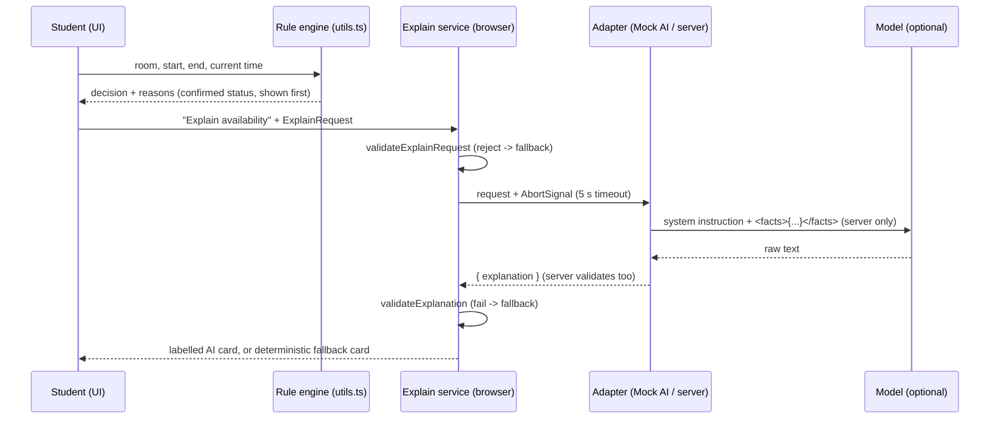

# Feature contract: "Explain availability" (Task 02)

## User story

> As a student, I want a short explanation of room availability so I understand the decision.

## Scope and trust boundary

- The deterministic rule engine (`evaluateAvailability` in `src/utils.ts`) decides **Available / Unavailable**. This is unchanged from Practice #10 (same rules, same order, same 26 old tests).
- The explanation feature only receives the decision as structured facts and returns text. It cannot change the decision, the reasons list or any booking. No booking is ever created.
- One room per check, fictional bookings, no login, no database.
- No API key in the browser. The live adapter runs on the server (Vite middleware) and reads `LLM_API_KEY` / `LLM_MODEL` from the server environment. The default **Mock AI** adapter runs offline and costs nothing.

## Flow (request → rule engine → LLM adapter → response)

Written flow: student input → `validateInterval` → `evaluateAvailability` → structured result → `buildExplainRequest` → adapter (mock in the browser, or `POST /api/explain` → `handleExplain` → model) → `validateExplanation` → UI. Any failure on the right side ends in the deterministic fallback; the left side never waits for or depends on the right side.

## Input contract — `ExplainRequest`

| Field | Type | Rule |
|---|---|---|
| `roomLabel` | string | 1–60 characters, letters/digits/space and `,'()&-` only, and must be one of the known fictional rooms |
| `start`, `end` | string | `HH:MM`, 00:00–24:00 |
| `isAvailable` | boolean | from the rule engine |
| `reasonCode` | `AVAILABLE`, `OVERLAP`, `ROOM_BLOCKED`, `START_NOT_AFTER_NOW`, `TOO_LONG`, `START_NOT_BEFORE_END`, `INVALID_BOOKING_DATA` | first failed rule; must agree with `isAvailable` |

Extra fields, missing fields, wrong types, non-JSON bodies and bodies over 1 KB are rejected (server: HTTP 400 / 413). Booking titles, student data and free text are **not** part of the request.

## Output contract — `{ explanation: string }`

Accepted only if, after whitespace cleanup, it:

- is 1–300 characters and at most two sentences;
- has no markup, links, braces or code characters;
- agrees with the decision (no "unavailable/blocked/overlap" words for an available slot; no "is available/you can book" for an unavailable one);
- claims no booking action ("I booked/reserved/cancelled…");
- mentions no time other than the requested start/end (or the rule limits 00:00/24:00) and no number other than the room label's digits and the 120-minute limit.

Otherwise the result is treated as a failure.

## Acceptance criteria

| ID | Criterion | Where enforced | Tests |
|---|---|---|---|
| EX-AC1 | Existing availability and overlap rules remain unchanged | `checkAvailability` wraps `evaluateAvailability`; grid test compares both | 26 old tests + "same decision and reasons" grid test |
| EX-AC2 | Explanation agrees with the deterministic result; no invented booking details | `validateExplanation`, request has no booking details | T1–T5, T10, validator tests, S4 |
| EX-AC3 | Empty, malformed or overly long input is rejected | `validateExplainRequest`, `handleExplain` size limit | T6, T7, T7b–d, S2 |
| EX-AC4 | Timeout, error or missing key gives a safe fallback | `explainAvailability` timeout + catch, server 503/504/502 | T8, T9, T9b, T9c, S1, S5 |
| EX-AC5 | Generated text is distinguishable from the confirmed status | "Confirmed by booking rules" label vs dashed violet "AI-generated explanation" card with adapter badge and disclaimer; gray "Standard explanation" for fallback | UI scenarios 01–11 |

## Failure behaviour

| Situation | Client result | Server status | UI label |
|---|---|---|---|
| Invalid request | fallback, adapter not called | 400 / 413 | Standard explanation · AI unavailable (input rejected) |
| No key configured | fallback | 503 | … (model not configured) |
| Model slower than 5 s (client) / 4 s (server) | fallback | 504 | … (timed out) |
| Provider error | fallback, no details shown | 502 | … (service error) |
| Model answer fails validation | fallback | 502 | … (answer failed the safety check) |

The fallback text is built only from the rule-engine facts, for example: *"Lecture Hall A is unavailable from 13:00 to 14:00 because that time overlaps an existing booking for this room."*

## Quality, latency and cost

- Quality: two-sentence limit, fixed vocabulary per reason code, output validator; the prompt sends five facts only.
- Latency: mock ≈ 0.3 s; live calls are capped at 4 s on the server and 5 s in the browser, and the confirmed status is shown immediately without waiting.
- Cost: mock mode is free; the live mode sends about 400 input tokens (system instruction + facts) and allows at most 1 024 output tokens per click, with low reasoning effort and no retries.
